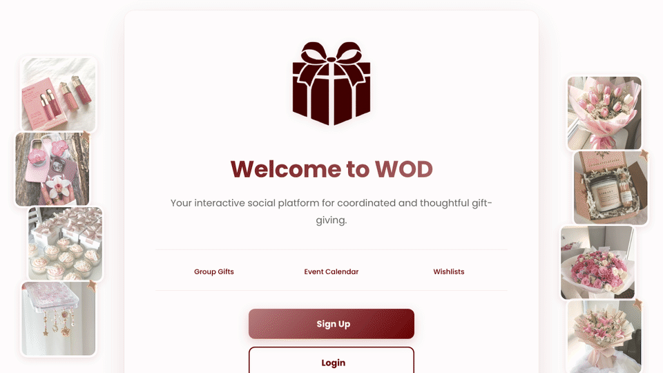

<h1 align="center">🎁 WOD: Social Gifting Platform</h1>

<b>A web platform for sharing wishlists, avoiding duplicate gifts, and planning group gifts with friends</b>

  

---

## 📁 Project Overview

Gift-giving often gets complicated: friends buy the same gift, group contributions get lost in chats, and important dates are forgotten. **WOD (Wish Our Day)** brings the whole gifting journey into one place, where users share wishlists, reserve gifts so no one buys the same thing twice, split group gifts, and keep track of occasions.

---

## ✨ Features

- **Accounts:** sign up and log in as a regular user or a store, with hashed passwords
- **Discover feed:** browse gift ideas with prices, like posts, and save them to your wishlist
- **Posts:** share gift ideas with an image, price, and external link
- **Profiles and friends:** search for users, follow and unfollow, and view friends' posts
- **Wishlists:** add items and control who can see your wishlist
- **Gift reservation:** reserve an item from a friend's wishlist so it is marked as taken
- **Group gifts:** start a group gift, split the price, and track contributions on a dashboard
- **Calendar:** add occasions and view your own and your friends' upcoming events

---

## 📌 Tools Used

- PHP and MySQL (PDO with prepared statements)
- HTML, CSS, and JavaScript
- MAMP and phpMyAdmin
- Jira (Scrum) and GitHub

---

## 🏗️ System Design

- **Architecture:** three-tier client–server design (presentation, application logic, and data layers)
- **Database:** 9 tables covering users, friendships, posts, likes, wishlists, wishlist items, group gifts, contributions, and occasions
- **Process:** built with Scrum and Jira, from 16 user stories gathered through interviews and a questionnaire

---

## 🧪 Testing

- **User story acceptance testing:** all 16 user stories passed their acceptance criteria
- **Integration testing:** features were integrated step by step and tested together
- **User acceptance testing:** 10 participants used the platform; all found registration, posting, and adding to a wishlist easy, and all agreed the reservation feature would prevent duplicate gifts

The full project report (requirements, design diagrams, and test results) is in [docs/WOD_Report.pdf](docs/WOD_Report.pdf).

---

## ▶️ Run Locally

1. Install [MAMP](https://www.mamp.info/) (or any PHP and MySQL server).
2. Copy the project folder into the server's web root (`htdocs`).
3. In phpMyAdmin, create a database named `wod_platform` and import `database/wod_platform.sql`.
4. Check the database settings in `config.php`, then open `http://localhost/WOD-Social-Gifting-Platform/index.php`.

---

## 👩‍💻 Team

- Ghada Alqahtani
- Renad Alowais
- Noura Alamro
- Shooq Alawdah
- Reema Alraqibah

Course: **IT 320**, King Saud University.

